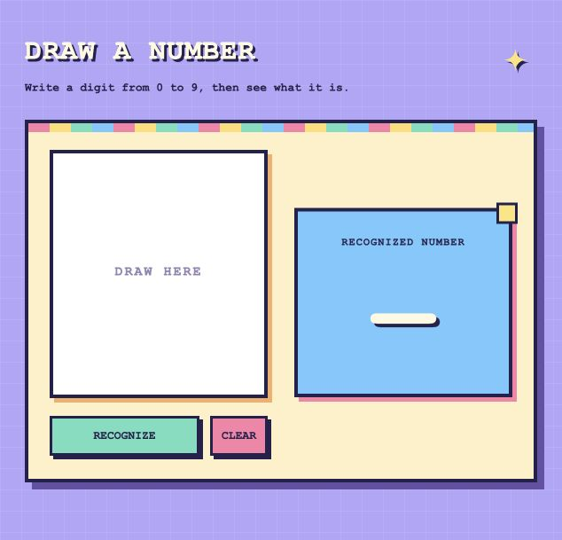

# Neural Network Character Recognition

Originally a Java/BlueJ digit recognition project; rebuilt with Python and TensorFlow.



A Python/TensorFlow CNN for handwritten **digits 0–9**, with a simple browser drawing canvas and recognized-number result, shared image preprocessing, and held-out model evaluation. This project replaces the original Java elastic stroke matcher. That original source and launcher are in `legacy-java/`.

## Run on macOS

Double-click `Run.command` in Finder, or run `zsh Run.command` from this folder in Terminal. The launcher opens http://127.0.0.1:5050. A trained model is included when available. Draw a large, centered digit and click **Recognize**; multiple strokes are supported. **Clear** starts a new drawing.

To install independently, use Python 3.11 or 3.12:

```sh
python3.11 -m venv .venv
source .venv/bin/activate
python -m pip install -r requirements.txt
python app.py
```

Stop the server with Ctrl+C in Terminal. If port 5050 is occupied, use `python app.py --port 5051`. `--no-browser` skips opening a browser.

## Train and evaluate

The browser interface shows only drawing and recognition. Training and evaluation are available from the command line. The default is **10,000 training samples, 2,000 validation samples, and all 10,000 test samples**, with deterministic sampling seed 42. Completed runs save epoch history, a confusion matrix, and per-class precision/recall in the evaluation report.

Train from the command line:

```sh
python engine.py --epochs 5 --samples 10000
```

The first training run downloads the MNIST dataset; it is cached under `artifacts/keras-cache/`. Completed runs save `artifacts/model.keras` and `artifacts/report.json`. Restarting loads the saved model and evaluation automatically.

## Model and image processing

- Input: 28 × 28 grayscale image, float32 values in [0, 1].
- Shared preprocessing for dataset images and user drawings: crop ink bounds, preserve aspect ratio while resizing to fit 20 × 20, pad to 28 × 28, center by intensity-weighted center of mass, normalize. Browser drawings are inverted to white ink on black.
- CNN: Conv2D(32, 3) → MaxPool → Conv2D(64, 3) → MaxPool → Flatten → Dense(64) → Dropout(0.3) → Dense(10, softmax).
- Adam optimizer, sparse categorical cross-entropy, batch size 128.
- Training and validation images come from disjoint subsets of MNIST's training partition. The test partition is used only for final evaluation, never for fitting or selecting the network.

## Accuracy claims

**89% is the requested target, not a hardcoded result.** The evaluation report records the measured test accuracy. See `artifacts/report.json` for sample counts, loss, accuracy, elapsed time, per-digit metrics, confusion matrix, TensorFlow version, and epoch history. MNIST benchmark accuracy is different from accuracy on new mouse-drawn digits. This version does not recognize letters or words.

The included model achieved **97.36% held-out test accuracy** (9,736 correct / 10,000 test digits), with **96.95% validation accuracy**, after five epochs using 10,000 training samples. Test cross-entropy loss was 0.0843. These values come from the actual saved evaluation report; later training runs may produce different results.

## Validation

```sh
python -m unittest discover -s tests -v
```

Tests cover normalization, blank rejection, centering, stroke aspect ratio, inference parity between dark/light input, model reload, prediction probabilities, and the local API's request validation.

Reference APIs: [Keras MNIST CNN example](https://keras.io/examples/vision/mnist_convnet/), [Keras callbacks](https://keras.io/api/callbacks/), [TensorFlow installation](https://www.tensorflow.org/install/pip).
